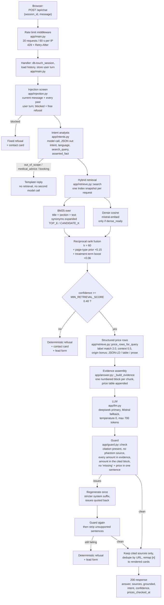
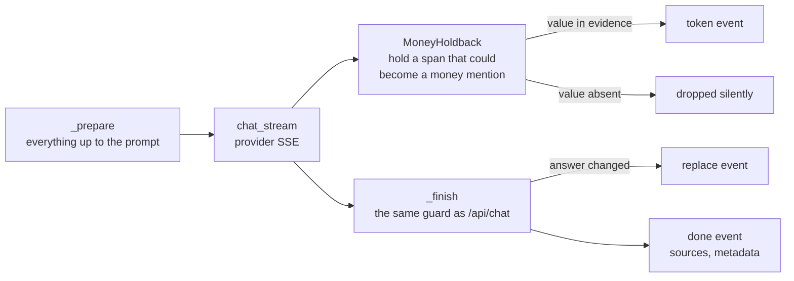

# Architecture

One process, one in-memory index, seven pages. No vector database, no worker
queue, no message broker.

## One request, end to end

`prices_checked_at` is `data/corpus.json`'s `built_at` date, and is sent only
when the answer carried price rows (`app/answer.py`, `prices_checked_at=`). It
tells the visitor which snapshot the figures came from, not when the clinic last
changed them.

## Modules

| Module | Responsibility |
| --- | --- |
| `app/main.py` | FastAPI app: routes, rate-limit and cache-header middleware, request logging to SQLite |
| `app/config.py` | Every setting, read once from the environment with a working default |
| `app/sources.py` | The seven allowed URLs and their page types; the only list of pages anywhere |
| `app/fetch.py` | Fetch those seven URLs politely: robots check, delay, on-disk cache in `data/raw/` |
| `app/extract.py` | Turn HTML into clean markdown plus structured price rows and FAQ pairs |
| `app/chunk.py` | Split markdown into ~900-character chunks on headings, keep tables whole |
| `app/ingest.py` | Run fetch, extract and chunk, and write `data/corpus.json` |
| `app/refresh.py` | Re-crawl on a schedule or admin request; refuse a corpus that shrinks too far or loses pages |
| `app/store.py` | Frozen `Index` snapshot: chunks, BM25 matrix, IDF, optional dense vectors; search primitives |
| `app/retrieve.py` | Fuse BM25 and dense with RRF, apply priors, compute confidence, look up price rows |
| `app/intents.py` | Classify one message: intent, language, English search query, asserted fact |
| `app/injection.py` | Block prompt-override and prompt-exfiltration attempts before any model call |
| `app/answer.py` | Assemble evidence, call the model, run the guard, regenerate or refuse, build sources |
| `app/guard.py` | Check citations and every money amount against the evidence blocks |
| `app/llm.py` | OpenAI-compatible chat client with fallback models and a bounded timeout |
| `app/ratelimit.py` | Per-IP sliding window over the two routes that cost money |
| `app/db.py` | SQLite: sessions, messages, leads, feedback, unanswered log, stats |
| `frontend/` | Next.js 16 static export: the shipped UI. Brand values from `docs/BRAND.md`, components in `app/components/`, styles in `app/globals.css` (tokens) and `app/ui.css` |
| `web/` | The original no-build UI, kept as the fallback when `frontend/out` is absent |

## Where two limits live

**Seven pages.** `app/sources.py` holds the tuple `SOURCES`. It is hard-coded and
the crawler in `app/fetch.py` fetches exactly that tuple and follows no links.
Adding a page means editing that file; nothing else discovers pages.

**Corpus rebuild.** `app/refresh.py::run` re-fetches, re-extracts and re-chunks
the seven pages, then calls `check_corpus` before writing. A build is rejected
when fewer than seven pages extract, when any page falls below 400 characters,
when a page loses more than half its characters, when a page that listed prices
now lists none, or when the chunk count or price-row count falls by more than
10% — that is what stops a broken extractor from quietly replacing good content
with a login page. The admin routes
`POST /api/admin/refresh` and `GET /api/admin/refresh/status` expose it, and
`python -m app.ingest` does the same build offline.

The store watches the corpus hash on startup and swaps a complete new `Index` in
one assignment, so a request that takes `store.snapshot` once cannot read chunks
from one build and BM25 scores from another.

## Streaming

`POST /api/chat/stream` is the same pipeline as `POST /api/chat`, with two
differences: the generation step reads the provider's SSE stream, and the text
passes through `app/stream.py::MoneyHoldback` before it is sent.

Events in order: `stage(retrieving)`, `stage(drafting)`, `token` many times,
optional `replace`, `done`. The filter holds back any span that could still
become a money mention and releases it only if its value appears in the evidence.
An unsupported figure is dropped, not shown and retracted.

## What is deliberately not here

- **Semantic cache.** Answers depend on retrieved evidence, and the evidence
  changes whenever the corpus is rebuilt. A cached answer keyed only on the
  question would outlive the price it quotes. A cache keyed on the corpus hash
  is a correct design, and at this traffic it buys nothing.
- **Reranking.** A cross-encoder on 24 candidates would add a second model to
  the critical path for a ranking problem that the evidence shows is caused by
  three near-duplicate package pages, not by a weak re-ranker. Fixing the
  duplicates is cheaper and more predictable. See `docs/EVALUATION.md`.
